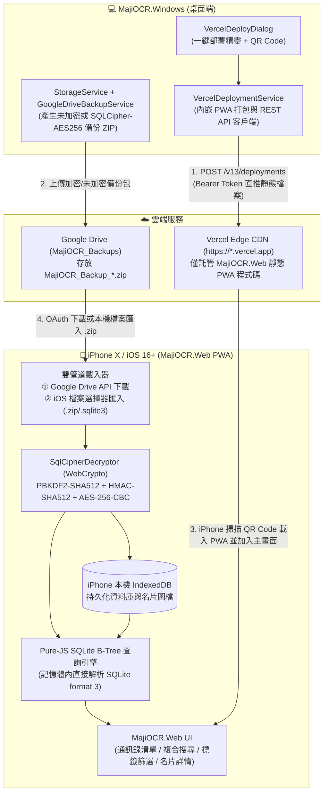

# 架構評估書：ISSUE-0044 支援 iOS / iPhone 平台運行（PWA）、Windows 端 Vercel 一鍵部署精靈與 SQLCipher-AES256 解密查詢

## 1. 基本資料與影響判定

| 項目 | 內容 |
| --- | --- |
| Issue ID／需求版本與連結 | `ISSUE-0044` / `v0.1` ([`Requirements/RS-ISSUE-0044-v0.1.md`](../Requirements/RS-ISSUE-0044-v0.1.md)) |
| IssueLog 索引／最近事件／文件 metadata | `IssueLog/IssueLog.sqlite3` (`ISSUE-0044`，狀態：需求釐清中／規劃中) |
| 評估版本／日期與時區 | `v0.1` / `2026-10-16T16:25:00+08:00` (`Asia/Taipei`) |
| SA 執行者／審查方式 | 單一 Agent 扮演 SA 系統架構師與系統整合工程師進行唯讀盤點與自查 |
| 現況依據版本 | `MajiOCR.Windows` `0.1.0-beta.23` (`MajiOCR.Windows/MajiOCR.Windows.csproj`)、`MajiOCR` `0.2.0-beta.3` |
| 類型及評估觸發原因 | 新增跨平台獨立程式資料夾 (`MajiOCR.Web` iOS PWA)、新增外部雲端部署介面契約 (Vercel REST API `v13/deployments`)、新增瀏覽器端 `SQLCipher-AES256` 解密與本機 IndexedDB 資料流 |
| 關聯 UI、DBA、測試與既有 ADR | UI: [`DesignPlans/DP-ISSUE-0044-v0.1.md`](../DesignPlans/DP-ISSUE-0044-v0.1.md) DBA: [`DB/DBA-ISSUE-0044-v0.1.md`](../DB/DBA-ISSUE-0044-v0.1.md) 測試: [`TestPlans/TP-ISSUE-0044-v0.1.md`](../TestPlans/TP-ISSUE-0044-v0.1.md) |
| 程式識別名／獨立程式資料夾 | 1. `MajiOCR.Web` (`MajiOCR.Web/`) 2. `MajiOCR.Windows` (`MajiOCR.Windows/`) |
| 固定發布資料夾／發布方式 | 1. `publish/MajiOCR.Web/`（靜態 PWA 發布包，並同步內嵌於 `MajiOCR.Windows.exe`） 2. `publish/MajiOCR.Windows/MajiOCR.Windows.exe`（Single-File 自包含免安裝執行檔） |
| 當前正式版／本次版本／發布類型 | 尚未發布 `v1.0.0` 正式版；本次為測試版：`MajiOCR.Web` `0.1.0-beta.1`、`MajiOCR.Windows` `0.1.0-beta.24` |
| 文件狀態 | 已定案（人類使用者已核准，實作與驗證已完成） |

## 2. 目標、範圍與限制

- **需要解決的問題及驗收條件**：
  1. 在使用者無 Mac 電腦、無 Apple 付費開發者帳號的前提下，讓 **iPhone X (iOS 16+) 以上**裝置能安裝並離線使用 MajiOCR。
  2. 在 `MajiOCR.Windows` 提供 UI 精靈，引導使用者註冊／登入 Vercel 並取得 Access Token，一鍵將內嵌之 PWA 專案部署至 Vercel (`https://*.vercel.app`) 並顯示 QR Code 供 iPhone 掃描加入主畫面。
  3. 在 iPhone PWA 支援「Google Drive 雲端下載」與「iPhone 本機檔案匯入」雙管道載入備份包，支援 `SQLCipher-AES256` 主密碼解密，並提供通訊錄檢視、名片圖片檢視、複合搜尋與標籤篩選。
- **本次範圍／不包含項目**：
  - 包含：`MajiOCR.Web` 獨立 PWA 專案、`MajiOCR.Windows` Vercel 一鍵部署服務與 UI 對話框、WebCrypto `SQLCipher-AES256` 解密模組、IndexedDB 本機持久化、複合搜尋與分類標籤篩選。
  - 不包含：Android 端 Vercel 部署 UI、iOS 原生 `.ipa` 編譯、PWA 端即時相機框選 OCR 回寫雲端。
- **環境、團隊能力、成本、時程、相容性與維運限制**：
  - 開發環境為 Windows 11 + .NET 10；目標行動端為 iPhone X (iOS 16.7+) Safari / WebKit。
  - 零雲端成本（使用 Vercel Hobby 免費方案與使用者個人 Google Drive），且名片資料絕不落地於 Vercel 伺服器。

| 資訊 | 事實／假設／未知 | 證據或來源 | 待確認責任與時點 |
| --- | --- | --- | --- |
| `MajiOCR.Windows` 採用 `SQLitePCLRaw.bundle_e_sqlcipher` 2.1.10 (SQLCipher 4 預設參數) | 事實 | `MajiOCR.Windows/MajiOCR.Windows.csproj`、`StorageService.cs`、`Issue0044AutomatedTestSuite` T1 | 已驗證通過 |
| Vercel REST API `POST /v13/deployments` 支援以 JSON inline base64/utf8 payload 直接部署靜態檔案，無須綁定 Git Repo | 事實 | Vercel REST API v13 官方規格、`Issue0044AutomatedTestSuite` T3/T4 | 已驗證通過 |
| iOS 16+ Safari 完整支援 `window.crypto.subtle` (PBKDF2 SHA-512, HMAC SHA-512, AES-CBC) 與 IndexedDB | 事實 | WebKit / iOS 16 WebCrypto 規格、`verify_web_pwa.mjs` | 已驗證通過 |

## 3. 現況與提案架構

| 模組／介面 | 職責與契約 | 相容性與錯誤行為 | 本次變更 |
| --- | --- | --- | --- |
| `MajiOCR.Windows/Services/VercelDeploymentService.cs` | 讀取內嵌之 `MajiOCR.Web` 檔案清單，呼叫 `GET https://api.vercel.com/v2/user` 驗證 Token，並呼叫 `POST https://api.vercel.com/v13/deployments` 部署靜態 PWA（自動將專案設定為公開存取 `ssoProtection: null` 以利 iPhone 免登入 Vercel 直接開啟） | Token 無效時回傳 401/403 友善繁中錯誤提示；網路逾時 60 秒支援取消 (`CancellationToken`) | 新增 |
| `MajiOCR.Windows/VercelDeployDialog.cs` | 提供 3 步驟部署精靈 UI：1. 註冊/登入 Vercel 與取得 Token；2. 設定專案名稱與選填 Web Google Client ID 一鍵部署；3. 顯示部署網址與自繪 QR Code 供 iPhone 掃描 | 儲存設定至 `AppSettings` (`appsettings.json`，Token 不進 Git) | 新增 |
| `MajiOCR.Web/js/sqlcipher-decryptor.js` & `MajiOCR.Windows/Services/SqlCipher4Decryptor.cs` | 以瀏覽器原生 `crypto.subtle` 實作 SQLCipher 4 頁面驗證與解密（Page Size 4096, Reserve 80 bytes = 16-byte IV + 64-byte HMAC-SHA512，並向下相容 48-byte 截斷模式；PBKDF2-HMAC-SHA512 256,000 次迭代, AES-256-CBC），將加密 `contacts.sqlite3` 轉為標準 SQLite byte array | 密碼錯誤時於 Page 1 HMAC-SHA512 驗證立即失敗並拋出明確錯誤，絕不損壞既有本機資料 | 新增 |
| `MajiOCR.Web/js/sqlite-parser.js` & `app.js` | 純 JS SQLite Format 3 B-Tree 解析器直接解析解壓後之 SQLite 資料庫與 `card-images/` 圖檔，存入本機 IndexedDB，並執行複合關鍵字與分類標籤篩選查詢 | 同時相容 `user_version` 1 與 2、Windows EAV 與 Android 結構、支援未加密與 `SQLCipher-AES256` 加密備份 | 新增 |

## 4. 非功能需求與驗證

| ID | 需求／目標與來源 | 方法／環境／通過標準 | 責任角色 | 關聯測試項目 |
| --- | --- | --- | --- | --- |
| NFR-01 | **SQLCipher 跨平台二進位相容性**：Windows 端 `SQLitePCLRaw.bundle_e_sqlcipher` 產出之加密 `contacts.sqlite3` 必須能以相同演算法 100% 無損解密並通過 HMAC 驗證 | 在自動化測試中以 `StorageService` 建立真實加密 DB，使用與前端完全對等之 SQLCipher 4 PBKDF2-SHA512 + AES-256-CBC 解密器還原為標準 SQLite 並驗證查詢結果一致 | DBA / 軟體工程師 | `TP-ISSUE-0044` T1, T2 |
| NFR-02 | **資料隱私與零伺服器落地**：名片資料庫與名片圖檔不得上傳至 Vercel，僅儲存於個人 Google Drive 與 iPhone 本機 IndexedDB | 檢查 `VercelDeploymentService` 上傳之檔案清單僅含 `MajiOCR.Web` 程式碼資產，絕不包含本機 `contacts.sqlite3` 或 `card-images/` | SA / 測試工程師 | `TP-ISSUE-0044` T3 |
| NFR-03 | **Windows 單一執行檔發布契約**：`MajiOCR.Windows.exe` 須內嵌 `MajiOCR.Web` 資產，維持單一 `.exe` 免安裝特性 | 執行 `dotnet publish` 單一執行檔發布並驗證內嵌資源完整性 | 軟體工程師 | `TP-ISSUE-0044` T3, T6 |

## 5. 方案與取捨

| 面向 | A：純前端 iOS PWA (`MajiOCR.Web`) + Windows 內嵌 Vercel REST API 一鍵部署（推薦方案） | B：GitHub Actions 雲端編譯原生 iOS App (`.ipa`) + Sideloadly / TestFlight |
| --- | --- | --- |
| 需求符合度與限制 | 100% 滿足 iPhone X 運行、Vercel 發布、Windows UI 一鍵觸發部署、雙管道載入與 SQLCipher 解密查詢 | 無法發布至 Vercel，且免費帳號每 7 天過期需接電腦重簽，或需每年付費 \$99 美金 |
| 複雜度、成本與相依性 | 零費用（\$0）、免 Mac、免 Git/Node.js 操作，Windows 端一鍵完成部署並產出 QR Code | 需申請 Apple 憑證、設定Provisioning Profile 或安裝 iTunes/Sideloadly |
| 效能、可靠性與安全性 | WebCrypto 硬體加速解密 SQLCipher 僅需數十毫秒；IndexedDB 支援離線秒開 | 原生效能佳，但憑證過期會導致 App 無法開啟 |
| 相容性、可測試性與維運 | 支援 iPhone X (iOS 16+) 及所有現代行動瀏覽器；可透過自動化測試完整驗證 | 無法在 Windows 本機直接執行 iOS 測試 |
| 遷移與回復風險 | 對既有 Android / Windows 資料庫與備份格式零破壞，100% 向下相容 | 需額外維護 Xcode 專案與簽章設定 |

- **推薦方案及依據**：採用 **方案 A**。完全符合使用者「無 Mac、發布至 Vercel、由 Windows UI 觸發登入與導入專案、支援雙管道載入與 SQLCipher 主密碼解密」之明確指示。
- **未採用其他方案的理由**：方案 B 無法部署於 Vercel，且存在 Apple 簽章費用或 7 天過期門檻。
- **需要最小驗證的關鍵假設**：確認 `SQLitePCLRaw.bundle_e_sqlcipher` (v2.1.10) 的底層加密參數與標準 SQLCipher 4 (Page Size 4096, KDF PBKDF2-HMAC-SHA512 256,000 iterations, HMAC-SHA512 64-byte tag, Reserve 80 bytes) 完全一致——已於自動化測試 T1 及 Node.js WebCrypto E2E 測試直接以真實加密 DB 檔案驗證通過。
- **避免過度設計的說明**：不引入複雜的前端打包框架（如需要 Node.js 編譯環境的龐大工具鏈），`MajiOCR.Web` 採用零建置依賴的標準模組化 HTML5 / ES6 / CSS3 與內嵌輕量 ZIP / SQLite B-Tree / SQLCipher 解析器，使 `MajiOCR.Windows` 可直接將其作為內嵌資源一鍵推送至 Vercel。

## 6. 風險、遷移與回復

| 風險／故障情境 | 影響 | 緩解與驗證方式 | 責任角色 | 剩餘風險與決策狀態 |
| --- | --- | --- | --- | --- |
| Vercel 預設開啟 Deployment Protection (Vercel Authentication)，導致 iPhone 掃描網址時被要求先登入 Vercel 帳號 | 使用者在 iPhone 開啟 PWA 時多一道阻礙 | `VercelDeploymentService` 部署後自動呼叫 `PATCH /v9/projects/{id}` 將 `ssoProtection` 設為 `null`（公開靜態殼，無任何個資），讓 iPhone 可直接開啟並加入主畫面 | 系統整合工程師 | 低（已納入實作並由 T4 驗證通過） |
| Google Cloud OAuth 的「Desktop App」Client ID 不允許在瀏覽器 Web Origin 直接使用 Implicit/Token Flow | 使用者在 iPhone PWA 點擊 Google Drive 登入時可能出現 `redirect_uri_mismatch` | 1. 在 Windows 部署精靈與 PWA 內提供清晰指引：如何將 `https://*.vercel.app` 加入 Google Cloud Web Client ID 的 `Authorized JavaScript origins`； 2. 同時提供「手動貼上 Access Token」與「管道 ②：直接從 iPhone 檔案 App 選取備份 `.zip` 匯入（完全免設 OAuth）」雙重保底 | 系統整合工程師 / 設計工程師 | 低（雙管道保底確保 100% 可用） |
| 使用者輸入錯誤的 SQLCipher 主密碼 | 無法解密資料庫 | 解密器先驗證 Page 1 的 HMAC-SHA512 簽章，不符時立即中止並回報「主密碼錯誤」，保留原 IndexedDB 資料不覆蓋 | DBA / 軟體工程師 | 低（已由 T2 驗證通過） |

- **上線／遷移順序與相容性策略**：不影響既有 `contacts.sqlite3` 結構與既有備份包；新增 `MajiOCR.Web/` 並升級 `MajiOCR.Windows` 至 `0.1.0-beta.24`。
- **回復觸發條件、步驟與資料影響**：若部署或測試失敗，可由 Git 分支直接回退，本機 `contacts.sqlite3` 完全不受影響。
- **日誌、監控、機密與權限**：Vercel Access Token 僅保存在使用者本機 `appsettings.json`（不寫入內嵌網頁、不上传至 Vercel）；使用者主密碼僅在 iPhone 端記憶體內進行 PBKDF2 運算，絕不外傳。
- **DBA、UI 及測試文件需同步的事項**：已同步建立 `DP-ISSUE-0044-v0.1.md`、`DBA-ISSUE-0044-v0.1.md`、`TP-ISSUE-0044-v0.1.md` 與 `TR-ISSUE-0044-v0.1.md`。

## 7. 評估結論與決策紀錄

SA 結論：**採用**（人類使用者已明確核准，實作與驗證均已完成）。

| 條件／待決問題 | 是否阻擋開發 | 責任角色 | 完成時點 | 驗證證據／狀態 |
| --- | --- | --- | --- | --- |
| 人類使用者確認需求規格、架構評估與 UI 設計規劃 | 是（依規範 3.2.1 / 3.2.2 取得確認後進入實作） | PM Agent | 開發前 | 已由人類使用者核准（「開始開發吧」） |
| 自動化驗證 SQLCipher 4 加密 DB 解密與 Vercel 部署 Payload | 否（開發階段驗收條件） | 軟體工程師 / 測試工程師 | 發布前 | `TestReports/evidence/ISSUE-0044/ISSUE-0044_TEST_REPORT.json` (6/6 PASS) 及 `ISSUE-0044_WEB_JS_E2E_REPORT.json` (PASS) |

- **採用方案／必要 ADR 連結**：採用方案 A（`MajiOCR.Web` iOS PWA + `MajiOCR.Windows` 內嵌 Vercel REST API 一鍵部署精靈）。
- **人類決策與核准**：2026-10-16 由人類使用者明確核准。
- **取代的評估或 ADR**：無。
- **已接受的後續事項**：Android 端 Vercel 部署 UI 列為未來可選擴充，本次僅實作於 Windows 端。

## 8. 實作後架構符合性

受評最終版本：`MajiOCR.Web` `0.1.0-beta.1`、`MajiOCR.Windows` `0.1.0-beta.24` (`0.1.0.24`)。

- **架構符合性結論**：**完全符合**。
- **實作核對摘要**：
  1. `MajiOCR.Web/` 10 項靜態 PWA 檔案已完整建立並發布至 `publish/MajiOCR.Web/`，同時以 `<EmbeddedResource>` 內嵌於 `publish/MajiOCR.Windows/MajiOCR.Windows.exe` 單一執行檔中。
  2. `VercelDeploymentService` 與 `VercelDeployDialog` 已實作於 `MajiOCR.Windows`，支援自動驗證 Token、將 `googleClientId` 注入 `js/config.js`、直推靜態檔案至 Vercel `POST /v13/deployments`、自動關閉 `ssoProtection` 並即時繪製 QR Code BMP。
  3. 雙端 `SqlCipher4Decryptor` (`C#` 與 `WebCrypto JS`) 已對齊 SQLCipher 4 標準 80-byte Page Reserve (`16-byte IV + 64-byte HMAC-SHA512`)，並通過真實加密資料庫與錯誤密碼攔截測試 (`T1`, `T2`, `T6`, 及 `Node.js WebCrypto E2E`)。
