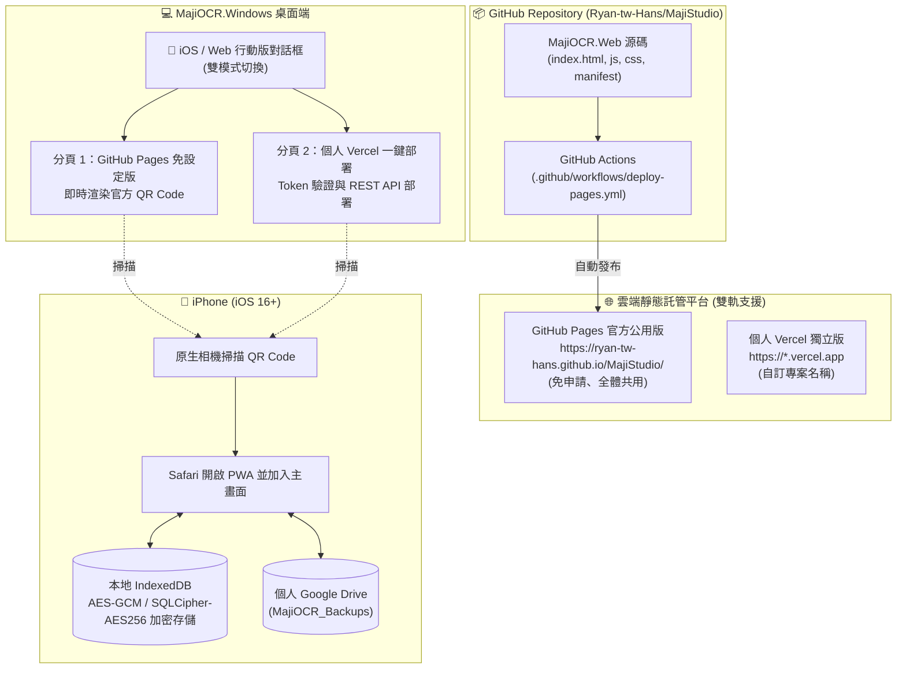

# 架構評估書：ISSUE-0047 支援 iOS PWA GitHub Pages 公用版發布與 QR Code 快速加入，並保留個人 Vercel 一鍵部署功能

## 1. 基本資料與影響判定

| 項目 | 內容 |
| --- | --- |
| Issue ID／需求版本與連結 | `ISSUE-0047` / `v0.1` ([`Requirements/RS-ISSUE-0047-v0.1.md`](../Requirements/RS-ISSUE-0047-v0.1.md)) |
| IssueLog 索引／最近事件／文件 metadata | `IssueLog/IssueLog.sqlite3` (`ISSUE-0047`，狀態：進行中) |
| 評估版本／日期與時區 | `v0.1` / `2026-10-17T12:38:00+08:00` (`Asia/Taipei`) |
| SA 執行者／審查方式 | 單一 Agent 扮演 SA 系統架構師與系統整合工程師進行現況盤點與架構評估 |
| 現況依據版本 | `MajiOCR.Web` `0.1.0-beta.1`、`MajiOCR.Windows` `0.1.0-beta.24` |
| 類型及評估觸發原因 | 擴充部署管道（GitHub Pages CI/CD）、調整 Web 靜態資源支援 Repo 子路徑、升級 Windows 端 iOS 行動版 QR Code 與對話框介面架構 |
| 關聯 UI、DBA、測試 | UI: [`DesignPlans/DP-ISSUE-0047-v0.1.md`](../DesignPlans/DP-ISSUE-0047-v0.1.md) DBA: 不適用（維持 SQLCipher-AES256 解密相容性） 測試: [`TestPlans/TP-ISSUE-0047-v0.1.md`](../TestPlans/TP-ISSUE-0047-v0.1.md) |
| 程式識別名／獨立程式資料夾 | 1. `MajiOCR.Web` (`MajiOCR.Web/`) 2. `MajiOCR.Windows` (`MajiOCR.Windows/`) |
| 固定發布資料夾／發布方式 | 1. `publish/MajiOCR.Web/`（靜態 PWA，並透過 GitHub Actions 發布至 GitHub Pages） 2. `publish/MajiOCR.Windows/MajiOCR.Windows.exe`（Single-File 自包含執行檔） |
| 當前正式版／本次版本 | 測試版：`MajiOCR.Web` `0.1.0-beta.2`、`MajiOCR.Windows` `0.1.0-beta.25` |
| 文件狀態 | 已定案（待軟體工程師實作） |

---

## 2. 目標、範圍與限制

- **需要解決的問題**：
  1. 降低 iPhone 使用者門檻：提供由專案發布的官方 GitHub Pages 公用免設定網址，使用者不需要自行註冊 Vercel 或申請 Token，只需以 iPhone 掃描 Windows 產生的 QR Code 即可一鍵加入主畫面。
  2. 保持彈性與後向相容：保留原本的 Vercel 一鍵部署功能，供想要擁有個人專屬雲端網址的使用者繼續使用。
  3. 保證資料私隱：公用版 PWA 依然堅持 Local-First 理念，伺服器純靜態託管，資料庫存放在使用者本地手機與個人 Google Drive。
- **本次範圍**：
  - `MajiOCR.Web`：靜態資源相對路徑適配（相容 `https://ryan-tw-hans.github.io/MajiStudio/` 及自訂網域）。
  - GitHub Actions：新增 `.github/workflows/deploy-pages.yml`。
  - `MajiOCR.Windows`：升級 `VercelDeployDialog.cs`（以 TabView 或雙模式介面整合「🌟 推薦：GitHub Pages 官方免設定版」與「⚡ 自訂：部署至個人 Vercel」），並支援在設定檔中保存自訂 GitHub Pages 網址。
- **不包含項目**：
  - 伺服器端資料庫或中央使用者登入後端（維持無伺服器純客戶端架構）。

---

## 3. 系統架構圖與資料流

---

## 4. 關鍵技術決策 (ADR 判定)

1. **GitHub Pages 子目錄 (Subpath) 與 PWA 相對路徑**：
   - GitHub Pages 部署於 `https://ryan-tw-hans.github.io/MajiStudio/`，其路徑非網站根目錄 `/`。
   - `manifest.webmanifest` 必須設定 `"start_url": "./"`、`"scope": "./"`。
   - `sw.js` 註冊時使用 `navigator.serviceWorker.register('./sw.js')`，確保其作用域限定在目前的目錄。
   - `index.html` 內的 `<link>`、`<script>`、`` 全部使用 `./` 相對路徑。
2. **Windows 端 UI 架構升級**：
   - 保留既有 `VercelDeployDialog` 呼叫簽名，內部改用 WinUI 3 `TabView` 或分頁切換容器：
     - **Tab 1（預設）**：GitHub Pages 官方免設定版。載入即直接顯示動態產生的 QR Code（300x300 高清），並提供複製網址、開啟瀏覽器與自訂網址輸入方塊。
     - **Tab 2**：個人 Vercel 部署。保留原有的 Access Token 輸入、驗證身分與 `VercelDeploymentService` 一鍵部署流程。
3. **安全與隱私不變性**：
   - GitHub Pages 為公用網址，所有靜態資產為公開讀取。
   - 名片資料庫與主密碼永遠只停留在使用者手機內部或使用者個人的 Google Drive，符合零信任（Zero-Trust）隱私架構。
