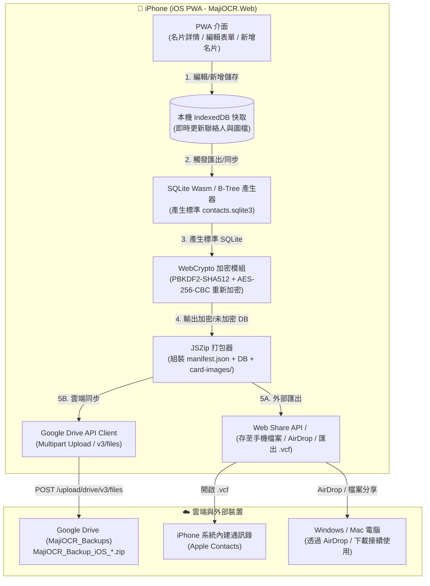

# 架構評估書：iOS PWA 名片編輯、SQLite Wasm / WebCrypto 雙向相容、Google Drive 雲端同步與外部匯出 (ISSUE-0049)

## 1. 基本資料與影響判定

| 項目 | 內容 |
| --- | --- |
| Issue ID／需求版本與連結 | `ISSUE-0049` / `v0.1` ([`Requirements/RS-ISSUE-0049-v0.1.md`](../Requirements/RS-ISSUE-0049-v0.1.md)) |
| IssueLog 索引／最近事件／文件 metadata | `IssueLog/IssueLog.sqlite3` (`ISSUE-0049`，狀態：已受理／規劃中) |
| 評估版本／日期與時區 | `v0.1` / `2026-10-17T15:20:00+08:00` (`Asia/Taipei`) |
| SA 執行者／審查方式 | 單一 Agent 扮演 SA 系統架構師與系統整合工程師進行現況盤點與架構評估 |
| 現況依據版本 | `MajiOCR.Web` `0.1.0-beta.1`、`MajiOCR.Windows` `0.1.0-beta.28` |
| 類型及評估觸發原因 | 擴充行動端 PWA 由「唯讀瀏覽」進入「雙向讀寫」，新增前端 SQLite 寫入引擎、SQLCipher 重新加密通道、Google Drive Multipart Upload 協議與 iOS 外部分享匯出契約 |
| 關聯 UI、DBA、測試與既有 ADR | UI: [`DesignPlans/DP-ISSUE-0049-v0.1.md`](../DesignPlans/DP-ISSUE-0049-v0.1.md) DBA: [`DB/DBA-ISSUE-0049-v0.1.md`](../DB/DBA-ISSUE-0049-v0.1.md) 測試: [`TestPlans/TP-ISSUE-0049-v0.1.md`](../TestPlans/TP-ISSUE-0049-v0.1.md) |
| 程式識別名／獨立程式資料夾 | 1. `MajiOCR.Web` (`MajiOCR.Web/`) 2. `MajiOCR.Windows` (`MajiOCR.Windows/`) |
| 固定發布資料夾／發布方式 | 1. `publish/MajiOCR.Web/`（PWA 靜態包） 2. `publish/MajiOCR.Windows/MajiOCR.Windows.exe`（內嵌最新 PWA 資產之免安裝單一執行檔） |
| 當前正式版／本次版本／發布類型 | 測試版：`MajiOCR.Web` `0.2.0-beta.1`、`MajiOCR.Windows` `0.1.0-beta.29` |
| 文件狀態 | 審查中 / 待使用者確認 |

---

## 2. 目標、範圍與限制

- **需要解決的問題及驗收條件**：
  1. 讓 iPhone X (iOS 16+) PWA 具備名片修改/新增/刪除操作，資料即時保存於本機 IndexedDB 快取。
  2. 具備匯出功能：完整 ZIP 備份包（支援 iOS Web Share API 儲存至檔案/AirDrop）與標準 vCard (`.vcf`) 匯出至 iPhone 內建通訊錄。
  3. 具備雲端同步功能：擴充 Google OAuth Scope，以 Multipart Upload 將最新修改打包上傳至 Google Drive `MajiOCR_Backups` 資料夾。
  4. 支援 SQLCipher 雙向加解密相容：若備份包為加密，寫出時自動依 SQLCipher 4 規格重新加密。
- **邊界與不包含項目**：
  - 本次不改動既有後端架構（維持 Serverless / 零雲端伺服器落地）。
  - 不包含即時聯機協同（Multi-device live sync），維持「以備份包版本為單位」的去中心化同步模型。

---

## 3. 架構圖與模組契約

---

## 4. 方案比較與關鍵取捨

| 考量面向 | 方案 A：sql.js (WebAssembly SQLite) + WebCrypto 加密（推薦方案） | 方案 B：純前端 JS 物件擬合 + JSON 備份 | 方案 C：架設 Node/C# 後端轉檔 API 伺服器 |
| :--- | :--- | :--- | :--- |
| **資料庫相容性** | **100% 相容**：直接在瀏覽器記憶體內產生標準 SQLite 3 二進位資料庫，相容 Windows / Android | 不相容：需改造 Windows 與 Android 解析非標準 JSON 格式 | 100% 相容，但增加伺服器依賴 |
| **架構純粹度與隱私** | **零伺服器落地**：所有計算與金鑰均在 iPhone Safari 沙盒內完成，隱私安全無虞 | 零伺服器，但破壞既有架構 | 破壞隱私契約：名片與密碼需傳輸至中繼伺服器 |
| **載入效能與成本** | 免費（\$0 伺服器成本），sql.js 經 Gzip 後約 200KB，可由 Service Worker 離線快取 | 成本零，但改造成本巨大 | 需負擔後端主機、憑證與維運成本 |
| **離線運作能力** | 支援完全離線編輯與本機檔案匯出 | 支援離線 | 離線時完全無法工作 |

**架構決策**：採用 **方案 A**。保持 Serverless、個人資料零伺服器落地原則，並完全相容既有 Android / Windows 生態系。
