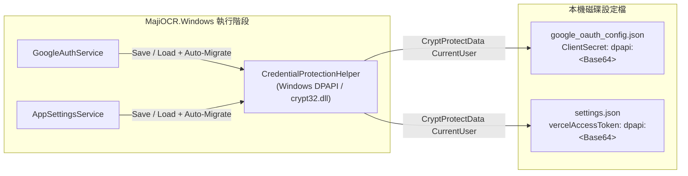

# 架構評估書：ISSUE-0050 清理 GitHub 公開儲存庫敏感資訊與本機憑證 Windows DPAPI 加密保護

## 1. 基本資料與影響判定

| 項目 | 內容 |
| --- | --- |
| Issue ID／需求版本與連結 | `ISSUE-0050` / `v0.1` ([RS-ISSUE-0050-v0.1.md](../Requirements/RS-ISSUE-0050-v0.1.md)) |
| IssueLog 索引／最近事件／文件 metadata | 本機 `IssueLog/IssueLog.sqlite3` (`ISSUE-0050`，狀態：進行中) |
| 評估版本／日期與時區 | `v0.1` / `2026-10-17T16:33:00+08:00` (`Asia/Taipei`) |
| SA 執行者／審查方式 | 單一 Agent 扮演 SA 系統架構師進行現況盤點與自查 |
| 現況依據版本 | `MajiOCR.Windows` `0.1.0-beta.29` (`4a23065`) |
| 類型及評估觸發原因 | 變更本機機密管理方式（導入 Windows DPAPI 加密儲存 `ClientSecret` 與 `VercelAccessToken`）與調整 Git 版本庫信任邊界（移出 `IssueLog.sqlite3`） |
| 關聯 UI、DBA、測試與既有 ADR | UI: 不適用 DBA: 不適用 測試: [TP-ISSUE-0050-v0.1.md](../TestPlans/TP-ISSUE-0050-v0.1.md) |
| 程式識別名／獨立程式資料夾 | `MajiOCR.Windows` (`MajiOCR.Windows/`) |
| 固定發布資料夾／發布方式 | `publish/MajiOCR.Windows/MajiOCR.Windows.exe`（Single-File 自包含免安裝執行檔） |
| 當前正式版／本次版本／發布類型 | 尚未發布 `v1.0.0` 正式版；本次為測試版 `0.1.0-beta.30` (`0.1.0.30`) |
| 文件狀態 | 已採用（人類使用者已確認方案） |

---

## 2. 目標、範圍與限制

- **需要解決的問題及驗收條件**：
  1. 解決 `google_oauth_config.json`（位於 EXE 旁便攜目錄）與 `%LocalAppData%\MajiOCR.Windows\settings.json` 以明文儲存 `ClientSecret` 及 `VercelAccessToken` 的風險，避免使用者壓縮分享整個程式資料夾或備份設定檔時外洩憑證。
  2. 維持單一免安裝執行檔（Single-File Portable Executable）無額外外部依賴契約，且支援既有明文設定檔無縫自動升級。
  3. 清理 Git 追蹤檔案中的個人絕對路徑、姓名、企業網域、Google Drive ID 與內部 `IssueLog.sqlite3`。
- **本次範圍／不包含項目**：
  - 包含：`CredentialProtectionHelper` DPAPI 加解密、平滑遷移、設定檔服務整合、儲存庫清理與單檔發布驗證。
  - 不包含：Git 歷史提交改寫（依使用者決策僅在最新 Commit 清理）。

---

## 3. 現況與提案架構

| 模組／介面 | 職責與契約 | 相容性與錯誤行為 | 本次變更 |
| --- | --- | --- | --- |
| `CredentialProtectionHelper` | 封裝 Windows `crypt32.dll` `CryptProtectData` / `CryptUnprotectData`（CurrentUser 範圍，附加固定應用程式 Entropy），輸出 `dpapi:<Base64>` 格式 | 若輸入無 `dpapi:` 前綴視為舊版明文直接回傳並標記需遷移；若跨電腦/跨帳號導致 DPAPI 解密失敗，安全回傳 `null` 避免程式崩潰 | 新增 `MajiOCR.Windows/Services/CredentialProtectionHelper.cs` |
| `GoogleAuthService` | 管理 `google_oauth_config.json` 讀寫 | 寫入時將 `ClientSecret` 轉為 `dpapi:` 密文；讀取時解密並對舊明文自動補寫密文 | 修改 `SaveOAuthConfigAsync` 與 `LoadOAuthConfigAsync` |
| `AppSettingsService` | 管理 `%LocalAppData%/MajiOCR.Windows/settings.json` 讀寫 | 寫入磁碟時將 `VercelAccessToken` 轉為 `dpapi:` 密文；讀取時解密並對舊明文自動補寫密文 | 修改 `LoadSettings` 與 `SaveSettings` |
| `UpdateService` / `DefaultUpdateSettings.json` | 預設軟體更新來源設定 | 若 `DefaultUpdateSettings.json` 或 `UpdateSettings.json` 含 `drive.google.com`，一律重設為預設 GitHub Releases API | 更新 `DefaultUpdateSettings.json` 與 `UpdateService.LoadSettings` |

---

## 4. 非功能需求與驗證

| ID | 需求／目標與來源 | 方法／環境／通過標準 | 責任角色 | 關聯測試項目 |
| --- | --- | --- | --- | --- |
| NFR-01 | 磁碟靜態憑證無明文殘留 | 呼叫 `SaveOAuthConfigAsync` 與 `SaveSettings` 後直接檢查 JSON 原文，不得包含明文 Secret/Token，且必須以 `dpapi:` 開頭 | 軟體工程師 / 測試工程師 | `TP-ISSUE-0050` TC-01, TC-02 |
| NFR-02 | 舊版明文設定平滑遷移 | 手動寫入明文 JSON 後呼叫 `LoadOAuthConfigAsync` / `LoadSettings`，驗證回傳正確明文且磁碟檔案已自動升級為 `dpapi:` 密文 | 軟體工程師 / 測試工程師 | `TP-ISSUE-0050` TC-03 |
| NFR-03 | 公開追蹤檔案零個資路徑殘留 | 掃描儲存庫檔案確認無本機個人使用者目錄路徑、無本機磁碟絕對連結、無特定姓名與舊版雲端硬碟資源 ID | 測試工程師 | `TP-ISSUE-0050` TC-04, TC-05 |

---

## 5. 方案與取捨

| 面向 | A：Windows 原生 DPAPI (`crypt32.dll` CurrentUser) + `dpapi:` 前綴平滑遷移 | B：Windows Credential Manager (`CredWrite` / `CredRead`) |
| --- | --- | --- |
| 需求符合度與限制 | 完整加密 JSON 內的敏感欄位，且若使用者將可攜目錄複製給他人，他人無法解密 `dpapi:` 密文 | 將秘密移出 JSON 存入系統認證管理員，但測試隔離（自訂測試設定檔路徑）較難獨立測試且容易污染本機全域認證表 |
| 複雜度、成本與相依性 | 零額外 NuGet 相依，直接呼叫 Windows 內建 `crypt32.dll` | 需管理 Credential Target 命名衝突與清除生命週期 |
| 遷移與回復風險 | 支援依檔案路徑獨立測試與舊明文原位平滑升級 | 舊檔案遷移後需額外同步刪除欄位 |

- **推薦方案及依據**：採用 **方案 A（Windows DPAPI CurrentUser + `dpapi:` 前綴平滑遷移）**。既能確保磁碟 JSON 檔案中不再出現明文憑證、防止可攜式資料夾誤分享導致外洩，又能保持 `AppSettingsService(customPath)` 與 `GoogleAuthService` 的單元測試隔離性與無外部套件相依。

---

## 6. 風險、遷移與回復

| 風險／故障情境 | 影響 | 緩解與驗證方式 | 責任角色 | 剩餘風險與決策狀態 |
| --- | --- | --- | --- | --- |
| 使用者將設定檔複製到另一台電腦或另一個 Windows 帳號 | DPAPI (CurrentUser) 無法在非原加密帳號下解密 | `CredentialProtectionHelper.Unprotect` 捕捉例外並安全回傳空字串/`null`，系統視為尚未設定 Token/Secret 並引導使用者重新輸入，絕不拋出未處理例外 | 軟體工程師 | 已緩解（符合安全預期） |

---

## 7. 評估結論與決策紀錄

- **SA 結論**：**可採用**。
- **人類決策與核准**：人類使用者於 2026-10-17 明確選擇移出 `IssueLog.sqlite3`、實作 Windows DPAPI 加密與平滑遷移、僅在最新 Commit 清理並改用 GitHub noreply 信箱。

---

## 8. 實作後架構符合性

- 受評最終版本：`0.1.0-beta.30` (`0.1.0.30`，單一執行檔 `publish/MajiOCR.Windows/MajiOCR.Windows.exe`，SHA-256: `7ED97B913F5D5952FF6AA26399AEFEA90296500860B99ECB5D792CD646D77D6A`)。

| 架構決策／條件 | 實作或測試證據 | 結果 | 偏差與處理 |
| --- | --- | --- | --- |
| Windows DPAPI (`CryptProtectData` CurrentUser) 加密 `ClientSecret` 與 `VercelAccessToken` | `MajiOCR.Windows/Services/CredentialProtectionHelper.cs`、`GoogleAuthService.cs`、`AppSettingsService.cs`；測試證據 `TestReports/evidence/ISSUE-0050/ISSUE-0050_TEST_REPORT.json` (`TC-0050-01`, `TC-0050-02`) | 符合 | 無偏差 |
| 舊版明文設定檔平滑自動升級與損毀密文安全回退 | `AppSettingsService.LoadSettings`（含 UTF-8 BOM 相容處理）、`GoogleAuthService.LoadOAuthConfigAsync`；測試證據 `TC-0050-03` | 符合 | 測試中發現含 UTF-8 BOM 之 JSON 需先剝除 `\uFEFF`，已修正並驗證通過 |
| 移除公開追蹤之個人路徑、姓名、舊 Drive ID 與 `IssueLog.sqlite3` | `.gitignore`、`DefaultUpdateSettings.json`、`CHANGELOG.txt`、`Issue0035AutomatedTestSuite.cs` 及 14 份相對路徑文件；測試證據 `TC-0050-04`, `TC-0050-05` | 符合 | 無偏差 |

- **SA 檢查結論**：**通過（符合已採用之架構決策與單檔免安裝發布契約）**。
