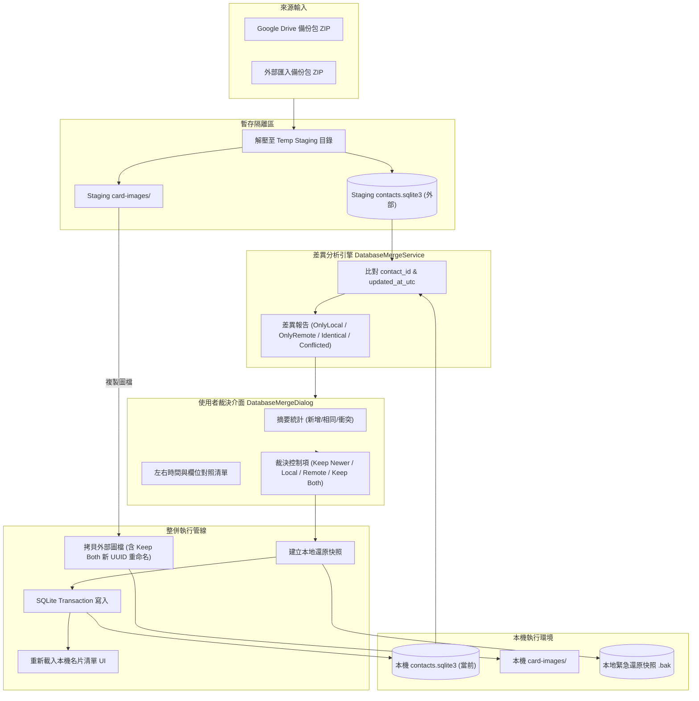

# 架構評估書：多裝置同步之資料庫整併與差異比對引擎架構 (AR-ISSUE-0052-v0.1)

- **對應 Issue ID**：`ISSUE-0052`
- **架構版本**：`v0.1`
- **評估日期**：`2026-10-18`
- **架構師角色**：SA 系統架構師 Agent

---

## 1. 架構目標與問題邊界

### 1.1 背景
既有 MajiOCR 在 Windows 端與雲端 Google Drive 或離線 ZIP 備份之間，僅提供整包覆蓋式還原（Restore Overwrite）。當使用者在多裝置（例如 iPhone 行動端外出拜訪客戶新增名片、Windows 桌面端編輯舊名片）同時產生異動時，整包覆蓋會抹除其中一端的最新資料。

### 1.2 核心架構目標
1. **解耦比對引擎 (Diff Engine)**：將差異比對邏輯抽離為獨立服務 `DatabaseMergeService`，可接收「本機資料庫連線」與「外部暫存資料庫連線」進行雙向分析。
2. **零阻斷與記憶體最佳化**：
   - 採用兩階段管線：
     - **Phase 1（唯讀分析與比對）**：將外部備份解壓至 staging 目錄，以唯讀模式讀取本機與外部資料庫的中繼資料與名片鍵值，產出差異模型 `DatabaseMergeDiffReport`。
     - **Phase 2（使用者互動裁決 UI）**：呈現比對結果，並收集使用者裁決集合（Resolution Map）。
     - **Phase 3（原子化整併寫入）**：在單一 SQLite Transaction 內落實寫入，若有任何失敗保證 100% Rollback，並在整併前自動建立本機防護快照。
3. **支援「兩側同時保留 (Keep Both)」之派生機制**：
   - 當名片判定衝突且裁決為 Keep Both 時，外部名片自動派生新 UUID `contact_id`，同步複製 EAV 欄位、標籤關聯與圖片檔（重命名為 `<new_uuid>_<side>.jpg`），杜絕主鍵與檔案名稱衝突。

---

## 2. 系統架構與資料流



---

## 3. 模組設計與介面契約

### 3.1 差異模型定義 (`DatabaseMergeModels.cs`)
```csharp
public enum MergeResolutionStrategy
{
    KeepNewer,     // 以較新時間為準
    KeepLocal,     // 保留本機
    KeepRemote,    // 採納外部
    KeepBoth       // 兩側同時保留 (外部複製為新 UUID)
}

public enum ContactDiffStatus
{
    OnlyInLocal,   // 本機新增
    OnlyInRemote,  // 外部新增
    Identical,     // 完全一致
    Conflicted     // 兩端皆有修改
}

public class ContactDiffItem
{
    public string ContactId { get; set; } = string.Empty;
    public ContactDiffStatus Status { get; set; }
    public ContactRecord? LocalRecord { get; set; }
    public ContactRecord? RemoteRecord { get; set; }
    public DateTime? LocalUpdatedAt { get; set; }
    public DateTime? RemoteUpdatedAt { get; set; }
    public bool IsRemoteNewer => (RemoteUpdatedAt ?? DateTime.MinValue) > (LocalUpdatedAt ?? DateTime.MinValue);
    public List<string> ChangedFieldDescriptions { get; set; } = new();
    public MergeResolutionStrategy UserResolution { get; set; } = MergeResolutionStrategy.KeepNewer;
}

public class DatabaseMergeDiffReport
{
    public List<ContactDiffItem> Items { get; set; } = new();
    public int OnlyInLocalCount => Items.Count(i => i.Status == ContactDiffStatus.OnlyInLocal);
    public int OnlyInRemoteCount => Items.Count(i => i.Status == ContactDiffStatus.OnlyInRemote);
    public int IdenticalCount => Items.Count(i => i.Status == ContactDiffStatus.Identical);
    public int ConflictedCount => Items.Count(i => i.Status == ContactDiffStatus.Conflicted);
}
```

### 3.2 服務契約 (`IDatabaseMergeService.cs`)
```csharp
public interface IDatabaseMergeService
{
    // 比對本機與外部資料庫差異
    Task<DatabaseMergeDiffReport> CompareDatabasesAsync(
        string localStorageRoot,
        string externalStorageRoot,
        string? externalPassphrase = null,
        CancellationToken ct = default);

    // 執行整併寫入
    Task<DriveOperationResult> ExecuteMergeAsync(
        string localStorageRoot,
        string externalStorageRoot,
        DatabaseMergeDiffReport diffReport,
        IProgress<BackupProgress>? progress = null,
        CancellationToken ct = default);
}
```

---

## 4. 非功能需求與限制 (NFR)
1. **安全性與資料保全**：
   - 整併執行前必須自動在 `backups/` 產出防護快照（例如 `pre_merge_backup_YYYYMMDD_HHmmss.sqlite3`）。
   - 支援外部加密資料庫輸入密碼解密後再進行比對。
2. **效能要求**：
   - 在 1,000 筆名片規模下，差異比對計算需在 1 秒內完成。
   - 圖片複製採用串流平行處理，避免 UI 凍結。
3. **無損性**：
   - 「兩側同時保留」產生的新名片與新圖檔，必須完整複製原外部名片之聯絡值、標籤及圖片，不可遺漏任何擴充欄位。
