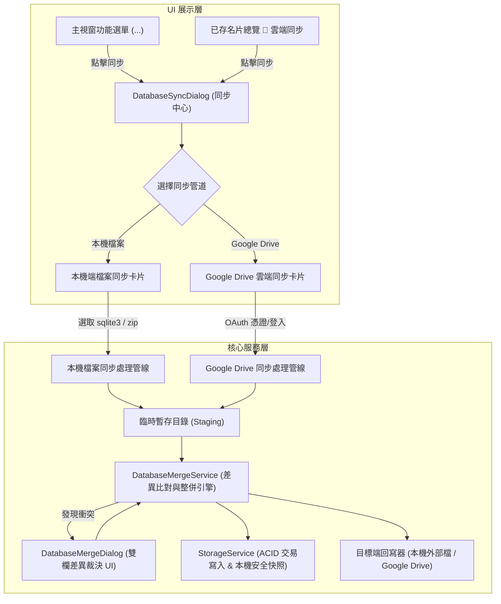

# 架構評估書：ISSUE-0053 功能選單新增資料庫同步入口、支援本機雙資料庫同步整併及雲端同步易用性優化

- **文件識別碼**：`AR-ISSUE-0053-v0.1`
- **關聯 Issue**：`ISSUE-0053`
- **關聯需求規格**：[RS-ISSUE-0053-v0.1.md](../Requirements/RS-ISSUE-0053-v0.1.md)
- **建立日期**：`2026-10-18`
- **負責角色**：SA 系統架構師 Agent

---

## 1. 系統架構與模組邊界

本設計擴充既有之 `DatabaseSyncDialog`，使其由單純的 Google Drive 雲端同步介面，演進為跨管道的 **「名片資料庫同步中心 (Database Sync Center)」**。

---

## 2. 核心機制設計

### 2.1 本機雙資料庫同步處理管線
1. **外部目標選取**：
   - 透過 `FileOpenPicker` 支援選取副檔名 `.sqlite3`, `.db`, `.zip`。
   - 若為 `.sqlite3` / `.db`，外部資料庫所在目錄亦可能存在 `card-images/` 目錄，整併時一併同步關聯圖檔。
   - 若為 `.zip`，解壓縮至隨機 Temporary Staging 目錄，提取 `contacts.sqlite3` 與名片圖檔。
2. **三種同步模式**：
   - **`PullToLocal` (從外部整併至本機)**：以目前本機為基準，將外部的新增/更新資料整併進本機資料庫。
   - **`PushToExternal` (從本機整併至外部)**：將本機的新增/更新資料整併寫入外部資料庫（或封裝為新 ZIP）。
   - **`Bidirectional` (雙向智慧整併)**：
     - 第一步：比對本機與外部差異，若有衝突喚起 `DatabaseMergeDialog` 裁決。
     - 第二步：將裁決後的整併結果寫入本機目前資料庫。
     - 第三步：將整併後的名片與圖檔寫回外部目標資料庫（若外部為 SQLite 檔案直接更新，若為 ZIP 則重新打包並取代原檔）。

### 2.2 Google Drive 雲端憑證就地設定
- 在雲端分頁中，直接嵌入 `Expander` 呈現 `ClientId`、`ClientSecret` 輸入框、儲存按鈕與「🔗 開啟 Google Cloud 憑證控制台」超連結。
- 儲存後直接更新 `IGoogleAuthService` 並啟用一鍵登入按鈕，消除跨視窗尋找設定的不良體驗。

---

## 3. 安全與例外防護
- 任何整併寫入前，一律在 `backups/` 產生帶有精確時間戳記的本機快照。
- 所有解壓縮與暫存工作均在 `Path.Combine(Path.GetTempPath(), ...)` 受控子目錄執行，並保證在 `finally` 區塊完全清理，無殘留檔案。
