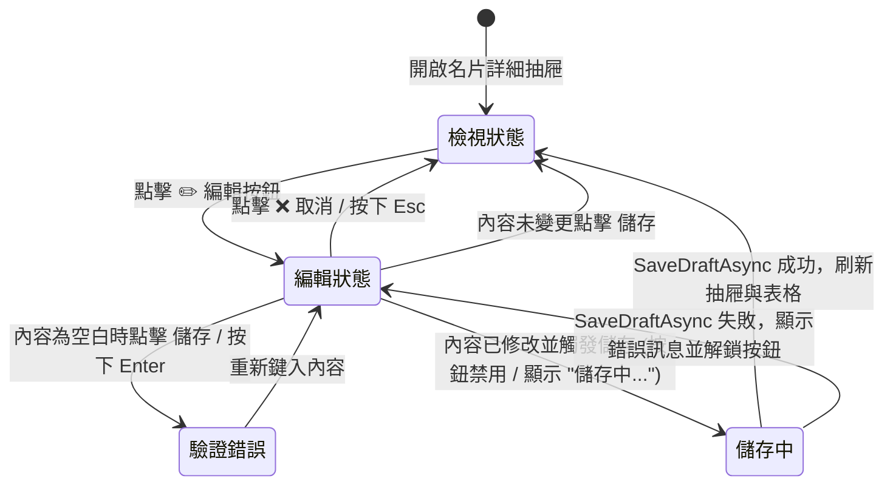

# 設計規格書：ISSUE-0060 已存名片詳細抽屜「確認欄位明細」單一欄位原地行內編輯設計

- **文件識別碼**：`DP-ISSUE-0060-v0.1`
- **關聯 Issue**：`ISSUE-0060`
- **建立日期**：`2026-10-30`
- **負責角色**：設計工程師 Agent
- **審核角色**：PM Agent、SA 系統架構師、軟體工程師、測試工程師

---

## 1. 介面視覺與排版規劃

### 1.1 「確認欄位明細」列版面配置 (Grid Layout)

原本每列資料排版為 2 欄：
- 第 0 欄（寬 70px）：欄位標籤（如「姓名」、「電話」）
- 第 1 欄（寬 1*）：內容文字 (`TextBlock`)

**更新後的 3 欄排版**：
- **第 0 欄**（寬 70px）：`labelText`，維持 11px SemiBold，透明度 0.75，向上對齊。
- **第 1 欄**（寬 1*）：內容區域容器（可動態切換檢視與編輯元件）。
- **第 2 欄**（寬 Auto）：操作按鈕區域。

```
+---------------------------------------------------------------+
| [標籤 70px] | [欄位內容文字 1*]                       | [✏️ 按鈕] |
+---------------------------------------------------------------+
```

進入編輯模式時，第 1 欄就地展開：
```
+---------------------------------------------------------------+
| [標籤 70px] | [TextBox 輸入框 (自動聚焦 & 全選)]                  |
|             | [✔️ 儲存] [❌ 取消]   (錯誤紅字提示...)              |
+---------------------------------------------------------------+
```

### 1.2 元件樣式規格

1. **✏️ 編輯按鈕 (`editBtn`)**：
   - 內容：`"✏️"`
   - 字級：`11px`
   - 內距：`Thickness(5, 2, 5, 2)`
   - 背景與外框：預設透明，滑鼠懸停時顯示系統輕量反白。
   - 垂直對齊：`VerticalAlignment.Top`
   - Tooltip：`ToolTipService.SetToolTip(editBtn, "編輯此欄位")`

2. **編輯輸入框 (`editBox`)**：
   - 控制項：`TextBox`
   - 字級：`12px`
   - 內距：`Thickness(6, 4, 6, 4)`
   - 邊距：`Thickness(0, 0, 4, 4)`
   - 互動支援：
     - `Loaded` 事件觸發 `Focus(FocusState.Programmatic)` 與 `SelectAll()`
     - `KeyDown` 事件攔截：`Enter` 觸發儲存、`Escape` 觸發取消。

3. **操作按鈕組 (`actionStack`)**：
   - 方向：`Orientation.Horizontal`，間距：`6px`，邊距：`Thickness(0, 2, 0, 2)`
   - **儲存按鈕 (`saveBtn`)**：
     - 內容：`"✔️ 儲存"`
     - 字級：`11px`
     - 樣式：套用 `(Style)Application.Current.Resources["AccentButtonStyle"]`
   - **取消按鈕 (`cancelBtn`)**：
     - 內容：`"❌ 取消"`
     - 字級：`11px`
   - **錯誤提示文字 (`errorText`)**：
     - 顏色：`SolidColorBrush(Colors.Red)`
     - 字級：`11px`
     - 預設 `Visibility = Visibility.Collapsed`

---

## 2. 狀態轉換與互動生命週期



---

## 3. 焦點與無障礙考量

- 點擊 ✏️ 時，抽屜不捲動跑位。
- 鍵盤友善：按 `Enter` 立即存檔，按 `Esc` 立即復原。
- 儲存成功後，若更動姓名或公司，左側表格保持原本選取項目並顯示新值，提供平滑視覺反饋。
