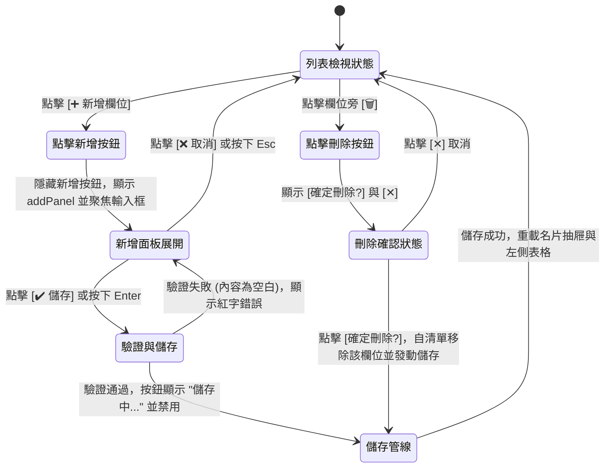

# 設計規格書：ISSUE-0061 已存名片詳細抽屜「確認欄位明細」新增與刪除欄位 UI/UX 設計

- **文件識別碼**：`DP-ISSUE-0061-v0.1`
- **關聯 Issue**：`ISSUE-0061`
- **建立日期**：`2026-10-31`
- **負責角色**：設計工程師 Agent
- **審核角色**：PM Agent、SA 系統架構師、軟體工程師、測試工程師

---

## 1. 介面視覺與排版規劃

### 1.1 「確認欄位明細」單列排版更新 (Row Layout)

原本排版：
- 第 0 欄（寬 70px）：欄位標籤（如「電話」、「姓名」）
- 第 1 欄（寬 1*）：檢視 / 行內編輯內容容器
- 第 2 欄（寬 Auto）：✏️ 編輯按鈕

**更新後排版**：
在第 2 欄操作區容納 `[✏️]` 與 `[🗑️]` 按鈕（水平排列，間距 4px）：
```
+-------------------------------------------------------------------------+
| [標籤 70px] | [欄位內容文字 1*]                       | [✏️] [🗑️]      |
+-------------------------------------------------------------------------+
```
- **[🗑️ 刪除按鈕]**：
  - 圖示：`"🗑️"`
  - Tooltip：「刪除此欄位」
  - 樣式：無框透明背景，滑鼠懸停微亮。
  - 互動防呆：點擊 `[🗑️]` 時，操作按鈕切換為確認狀態 `[確認刪除?] [✕]`，使用者再次點擊「確認刪除?」即發動刪除，若點「✕」或點擊他處則取消確認，防止手滑誤刪。

### 1.2 列表底端「➕ 新增欄位」入口與面板 (選項 B)

在 `_detailValuesStack` 欄位列表末尾放置：
1. **新增按鈕列 (`addBtnRow`)**：
   - 元件：`Button`
   - 內容：`"➕ 新增欄位"`
   - 寬度：`HorizontalAlignment.Stretch`（全寬）或左對齊，內距 `(10, 6, 10, 6)`
   - 邊距：`Thickness(0, 8, 0, 4)`
   - 字級：`12px`
   - 樣式：次要按鈕或虛線/輕量邊框按鈕。

2. **新增欄位面板 (`addPanel`)**（預設 `Visibility = Visibility.Collapsed`）：
   - 邊框：`Border` 包含輕微背景底色與卡片邊框，內距 8px。
   - 內容排列（垂直 `StackPanel`，間距 6px）：
     - **第一列：類別選擇**：
       - `ComboBox`（預設選中「電話」），包含選項：
         - 電話（Phone）
         - Email（Email）
         - 地址（Address）
         - 網站（Website）
         - 備註（Note）
         - 職稱（Title）
         - 公司（Company）
         - 姓名（Name）
         - 自訂欄位（Custom）
     - **第二列：自訂欄位名稱（僅在選中「自訂欄位」時顯示）**：
       - `TextBox`，`PlaceholderText = "請輸入欄位名稱 (如: Line ID、傳真)"`
     - **第三列：欄位內容**：
       - `TextBox`，`PlaceholderText = "請輸入欄位內容"`，支援鍵盤 `Enter` 快速儲存、`Esc` 取消。
     - **第四列：操作按鈕組與錯誤提示**：
       - `[✔️ 儲存]`：Accent 樣式按鈕。
       - `[❌ 取消]`：一般按鈕。
       - `TextBlock`（紅色字體，預設隱藏，驗證失敗時顯示）。

---

## 2. 狀態轉換與互動流程



---

## 3. 無障礙與使用者體驗規範

1. **新增防呆**：
   - 欄位內容不可純空白。
   - 若為「自訂欄位」，自訂名稱不可空白。
2. **刪除防呆**：
   - 提供雙步驟防手滑機制（點擊垃圾桶後切換為確認確認按鈕），不造成突兀中斷的對話框，又能防止誤按。
3. **儲存防重複送出**：
   - 儲存進行中禁用按鈕並切換為「儲存中...」。
