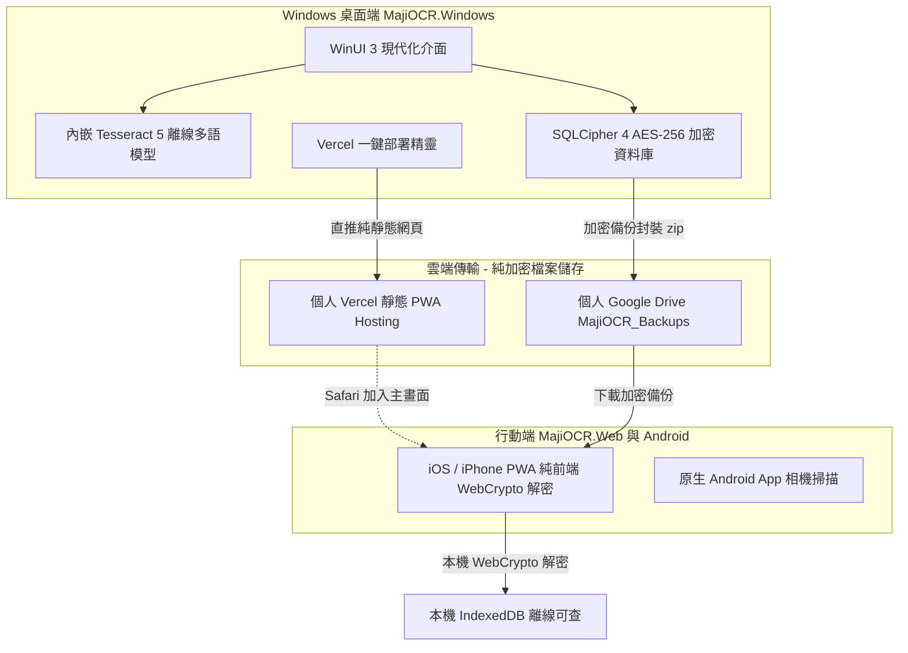

# MajiStudio (MajiOCR 名片辨識與跨平台通訊錄管理系統)

[](LICENSE)
[](https://github.com/Ryan-tw-Hans/MajiStudio/releases)
[](https://github.com/Ryan-tw-Hans/MajiStudio)
[](https://github.com/Ryan-tw-Hans/MajiStudio)
[-red.svg)](https://github.com/Ryan-tw-Hans/MajiStudio)

**MajiStudio (MajiOCR)** 是一套以**隱私安全為核心（Privacy-First）**的多平台名片光學字元辨識（OCR）與通訊錄管理系統。專為不需要、也不信任第三方商業雲端儲存敏感商務人脈的使用者設計。

系統具備**零中心資料庫、離線辨識、高強度 AES-256 加密與多端同步**能力，包含現代化 Windows 桌面端、iPhone (iOS 16+) 行動網頁版 (PWA) 以及原生 Android 應用。

---

## 🌟 核心特色與架構



---

### 1. 🖥️ Windows 桌面端 (`MajiOCR.Windows`)
* **單一免安裝執行檔 (Single-file Portable)**：.NET 10 + WinUI 3 架構，所有相依組件全部封裝於單一 `MajiOCR.Windows.exe`，免安裝、隨身碟隨插即用。
* **高精度離線 OCR 引擎**：內嵌 Tesseract 5 原生引擎與多國語系辨識模型（繁體中文、簡體中文、英文、日文、韓文），支援局部框選二度辨識。
* **靈活自訂欄位與分類標籤**：動態自訂聯絡人欄位（如 LINE ID、統編、私人備註等）與色票標籤系統。
* **軍規級資料庫加密**：採用 SQLCipher 4 (`SQLCipher-AES256`) 演算法（PBKDF2-HMAC-SHA512 256,000 次迭代），全面防禦資料庫被本機或惡意軟體讀取。
* **iOS / Web 雲端版 Vercel 一鍵部署精靈**：內建向導引導使用者部署個人專屬的行動 PWA，並自動產生 QR Code 供手機掃描。

### 2. 📱 iOS / 行動網頁版 (`MajiOCR.Web`)
* **專為 iPhone X / iOS 16+ 打造的 PWA**：Safari「分享 ➔ 加入主畫面」即化身全螢幕 App，支援離線快取與獨立運作。
* **100% 前端安全解密（零伺服器存取）**：採用 WebCrypto API 原生實作 SQLCipher 4 頁面解密與完整性校驗，主密碼絕不外洩。
* **純 JavaScript SQLite 引擎**：無外部 WASM/CDN 依賴，於瀏覽器端即時解析 B-Tree 頁面結構並持久化至 `IndexedDB`。
* **行動商務人脈查詢**：支援多關鍵字即時搜尋、正反面名片照片全螢幕檢視、一鍵撥號／寄信／開啟地圖，以及匯出 `.vcf` 直接加入手機聯絡人。

### 3. 🤖 原生 Android 端 (`MajiOCR`)
* 輕量化 Material Design 介面，內建離線相機辨識與名片資料管理。
* 具備名片拍照自動梯形校正與快速存檔機制。

---

## 🔒 隱私與安全性承諾 (Privacy & Security)

1. **無中央伺服器 (Zero-Knowledge Architecture)**：沒有任何由開發團隊架設的中央伺服器或商業資料庫，您的商務人脈資料 100% 屬於您自己。
2. **端到端加密備份 (E2EE)**：備份檔案在離開您的電腦前，即已透過您親自設定的主密碼進行 AES-256 加密。即使備份儲存於雲端硬碟，沒有密碼任何人（包括雲端廠商）都無法窺探。
3. **離線優先**：核心 OCR 辨識引擎與名片搜尋皆於本機離線運作，在無網路環境下亦能順暢使用。

---

## 🚀 快速開始

### Windows 桌面端
1. 前往 [Releases](https://github.com/Ryan-tw-Hans/MajiStudio/releases) 下載最新版 `MajiOCR.Windows.zip`。
2. 解壓縮後直接點擊 `MajiOCR.Windows.exe` 即可啟動。

### iOS / iPhone 行動網頁端
1. 在 Windows 端啟動 `MajiOCR.Windows.exe`。
2. 點擊右上角選單 `...` ➔ **「📱 部署 iOS / Web 雲端版 (Vercel)...」**。
3. 依照視窗指示輸入個人免費 Vercel Token 進行一鍵部署。
4. 使用 iPhone Safari 掃描畫面顯示的專屬 QR Code，點擊分享按鈕並選擇**「加入主畫面」**。
5. 匯入由 Windows 端備份的加密 `.zip` 或透過 Google Drive 連線，即可在手機端離線檢索名片！

---

## 🛠️ 開發環境與建置指南

### 需求條件
* **Windows 10/11** (建議 64-bit)
* **.NET 10 SDK** (含 Windows App SDK / WinUI 3 工作負載)
* **Visual Studio 2022+** (含通用 Windows 平台與 .NET 桌面開發套件)
* **Android Studio Ladybug+ / JDK 17+** (若需編譯 Android 端)

### Windows 桌面端發布建置
```powershell
# 直接輸出為單一免安裝自含執行檔
dotnet publish "MajiOCR.Windows/MajiOCR.Windows.csproj" `
  -c Release `
  -r win-x64 `
  -p:Platform=x64 `
  --self-contained true `
  -p:PublishSingleFile=true `
  -p:IncludeAllContentForSelfExtract=true `
  -p:IncludeNativeLibrariesForSelfExtract=true `
  -o "publish/MajiOCR.Windows"
```

---

## 📄 授權條款 (License)
本專案依 [MIT License](LICENSE) 授權開放。
