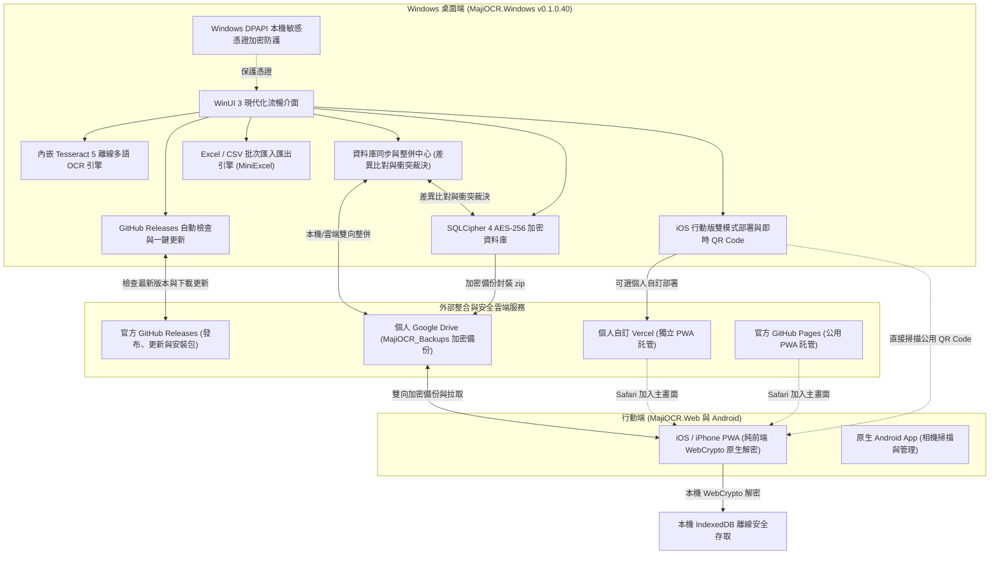

# MajiStudio (MajiOCR 名片辨識與跨平台通訊錄管理系統)

[](LICENSE)
[](https://github.com/Ryan-tw-Hans/MajiStudio/releases)
[](https://github.com/Ryan-tw-Hans/MajiStudio/releases)
[](https://ryan-tw-hans.github.io/MajiStudio/)
[](https://github.com/Ryan-tw-Hans/MajiStudio)
[-red.svg)](https://github.com/Ryan-tw-Hans/MajiStudio)

**MajiStudio (MajiOCR)** 是一套以**隱私安全為核心（Privacy-First）**的多平台名片光學字元辨識（OCR）與現代化通訊錄管理系統。專為重視資料自主權、不信任第三方商業雲端儲存敏感商務人脈的使用者量身打造。

系統具備**零中心資料庫、離線高精度辨識、軍規級 AES-256 加密、多端智慧同步整併、Excel/CSV 雙向批次匯入匯出**等全方位功能，包含現代化 Windows 桌面端、iPhone (iOS 16+) 行動網頁版 (PWA) 以及原生 Android 應用。

---

## 🌟 核心特色與架構全貌



---

## 🚀 三端核心功能

### 1. 🖥️ Windows 桌面端 (`MajiOCR.Windows`)

* **單一免安裝可攜執行檔 (Single-file Portable) 與完全可攜化 (True Portable)**：
  - 基於 .NET 10 + WinUI 3 打造，所有原生相依組件全面封裝於單一 `MajiOCR.Windows.exe`，隨身碟隨插即用。
  - 設定檔與自訂欄位完全存放於主程式同目錄，支援免依賴 `%LocalAppData%` 之真正綠色運作。
* **高精度離線 OCR 辨識引擎**：
  - 內嵌 Tesseract 5 原生引擎與多國語系辨識模型（繁體中文、簡體中文、英文、日文、韓文）。
  - 具備名片智慧梯形校正、旋轉與局部框選二度辨識能力。
* **🔐 專用離線加密名片分享包 (*.majicard) 與多選批次匯出 (v0.1.0.36 新增)**：
  - **表格常態多選 CheckBox**：名片清單支援常態複選框與表頭一鍵全選，狀態列即時反映選取數量。
  - **自訂匯出設定對話框**：支援自由切換「匯出所選」或「匯出全部」、自訂排除分類標籤與備註欄位。
  - **安全分享包 (*.majicard)**：採用純本地軍規 AES-256-GCM 認證加密與 PBKDF2 (100,000 次疊代)；接收端輸入密碼解密後可預覽清單，並勾選指定名片批次匯入資料庫。
* **⚡ 頂部檢查更新快捷按鈕與功能選單整併 (v0.1.0.36 新增)**：
  - 主畫面頂部主要工具列直接新增「🔄 檢查更新」按鈕，一鍵即時檢查版本。
  - 「...」功能選單將匯出與匯入整併為精簡子選單，高度縮減 30% 以上，徹底解決選單底部按鈕滾動遮蔽問題。
* **📊 Excel / CSV 雙向批次匯入與匯出引擎 (v0.1.0.35 新增)**：
  - **標準 Excel 匯出**：一鍵輸出標準 OpenXML 活頁簿 (`*.xlsx`)，包含姓名、公司、職稱、電話、Email、地址、標籤等完整欄位。
  - **通用 CSV 匯出**：輸出帶有 UTF-8 BOM 之 CSV 檔案 (`*.csv`)，雙擊在 Microsoft Excel 開啟中文絕不亂碼。
  - **智慧批次匯入**：自動比對檔案表頭與欄位名稱（支援繁中/簡中/英文模糊智慧對應），並內建「下載標準匯入範本 (Excel / CSV)」。
  - **重複資料智慧裁決**：提供「跳過重複」、「覆蓋更新」、「一律建立新名片」三種重複裁決模式，全程由 SQLite Transaction 交易保證零資料遺失。
* **🔄 多裝置資料庫同步與整併中心 (Sync & Merge Center, v0.1.0.32~v0.1.0.34 新增)**：
  - 支援兩份本機加密資料庫或雲端備份檔進行雙向差異比對。
  - **智慧衝突判定**：比對姓名/電話/公司及最後修改時間戳記，提供清晰的「僅本機」、「僅遠端」、「內容相同」、「資料衝突」四態標記。
  - **視覺化差異裁決**：支援自訂保留本機、保留遠端、雙向合併，或保留兩側（自動派生副本並加註標籤）。
  - **安全防護快照**：整併執行前自動建立備份快照至 `backups/`，防止誤操作。
* **軍規級資料庫加密與 Windows DPAPI 憑證防護**：
  - 採用 SQLCipher 4 (`SQLCipher-AES256` 演算法，PBKDF2-HMAC-SHA512 256,000 次迭代)，徹底阻絕未授權存取。
  - 本機憑證（如 Google OAuth Client Secret）改採 Windows DPAPI 本機密碼編譯技術儲存，即使檔案被複製亦無法在其他裝置解密。
  - 新增資料庫獨立密碼機制，杜絕密碼誤套用風險。
* **⚡ 現代化 GitHub Releases 自動升級機制**：
  - 啟動或手動檢查版本時，直接透過 GitHub API 取得最新版本資訊與 Markdown 變更紀錄。
  - 支援在應用程式內一鍵下載、校驗並無縫替換單一執行檔。
* **iOS / Web 行動版雙模式快速部署**：
  - **🌟 官方公用免設定版 (GitHub Pages)**：預設提供官方公用網址與即時 240x240 高解析度 QR Code，iPhone 相機一掃立刻加入主畫面，無須申請任何雲端帳號。
  - **⚡ 自訂個人部署 (Vercel)**：內建引導精靈，支援使用個人免費 Vercel Token 一鍵發布個人專屬網域。

---

### 2. 📱 iOS / 行動網頁版 (`MajiOCR.Web`)

* **官方公用網址**：[https://ryan-tw-hans.github.io/MajiStudio/](https://ryan-tw-hans.github.io/MajiStudio/)
* **專為 iPhone X / iOS 16+ 打造的 PWA**：Safari「分享 ➔ 加入主畫面」即化身全螢幕 App，支援離線快取與獨立運作。
* **100% 前端安全解密（零伺服器存取）**：
  - 採用 WebCrypto API 原生實作 SQLCipher 4 頁面解密與完整性校驗，主密碼絕不外洩。
  - 純 JavaScript SQLite 引擎無任何外部 WASM/CDN 依賴，於瀏覽器端即時解析 B-Tree 頁面結構並持久化至 `IndexedDB`。
* **行動商務人脈管理**：
  - 多關鍵字即時搜尋、正反面名片照片全螢幕檢視。
  - 一鍵撥號、發送 Email、開啟地圖導航，以及匯出 `.vcf` 直接加入手機通訊錄。
  - **雙向編輯與同步**：支援在手機端直接新增/編輯名片、雙向同步 Google Drive 備份及外部匯出 ZIP。

---

### 3. 🤖 原生 Android 端 (`MajiOCR`)

* 輕量化 Material Design 介面，內建離線相機辨識與名片資料管理。
* 具備名片拍照自動梯形校正與快速存檔機制。

---

## 🔒 隱私與安全性承諾 (Privacy & Security)

1. **無中央伺服器 (Zero-Knowledge Architecture)**：沒有任何由開發團隊架設的中央伺服器或商業資料庫，您的商務人脈資料 100% 屬於您自己。
2. **端到端加密備份 (E2EE)**：備份檔案在離開您的電腦前，即已透過您親自設定的主密碼進行 AES-256 加密。即使備份儲存於雲端硬碟，沒有密碼任何人（包括雲端廠商）都無法窺探。
3. **離線優先 (Offline-First)**：核心 OCR 辨識引擎、名片搜尋、Excel/CSV 匯入匯出皆於本機離線運作，在無網路環境下亦能順暢使用。
4. **本機機密保護**：雲端同步授權等機密資訊經由作業系統級 DPAPI 加密，嚴格限制存取邊界。

---

## 🚀 快速上手指南

### 1. Windows 桌面端啟動
1. 前往 [GitHub Releases](https://github.com/Ryan-tw-Hans/MajiStudio/releases) 下載最新版 `MajiOCR.Windows.zip`。
2. 解壓縮後直接點擊 `MajiOCR.Windows.exe` 即可啟動（免安裝、可直接置於隨身碟使用）。

### 2. 名片批次匯入與匯出 (Excel / CSV)
- **匯出**：在「已存名片總覽」點擊「📁 匯出」，選擇「匯出 Excel 表單 (*.xlsx)」或「匯出完整名片 CSV (*.csv)」。
- **批次匯入**：點擊「📥 匯入名片 (Excel / CSV)...」，選取您的客戶表單。系統會自動完成欄位比對並提供「跳過重複 / 覆蓋更新 / 建立新名片」三種裁決模式。您也可以在此對話框下載標準空白範本。

### 3. 多裝置資料庫同步與整併
- 點擊工具列或選單中的「🔄 資料庫同步與整併中心」。
- 選取另一台電腦備份或 Google Drive 下載的 SQLite 資料庫/ZIP 檔案。
- 系統將自動比對差異，您可以直觀檢視每筆衝突並選取整併策略，一鍵完成雙向整併。

### 4. iPhone / iOS 行動版使用
1. 在 Windows 端點擊右上角選單 `...` ➔ **「📱 iOS / Web 行動版」**。
2. 使用 iPhone 相機掃描畫面上顯示的 **GitHub Pages QR Code**（或 Safari 開啟 [https://ryan-tw-hans.github.io/MajiStudio/](https://ryan-tw-hans.github.io/MajiStudio/)）。
3. 於 Safari 點擊底部的「分享」圖示 ➔ 選擇**「加入主畫面」**。
4. 點擊「☁️ 載入/同步資料庫」，透過 Google Drive 或從 iPhone「檔案」App 匯入加密備份檔案即可隨身離線查閱。

---

## 🛠️ 開發環境與建置指南

### 需求條件
* **作業系統**：Windows 10/11 (x64)
* **SDK**：.NET 10 SDK (含 Windows App SDK / WinUI 3 工作負載)
* **IDE**：Visual Studio 2022+ 或 VS Code / JetBrains Rider
* **Android 端 (可選)**：Android Studio Ladybug+ / JDK 17+

### Windows 桌面端發布建置
```powershell
# 輸出單一免安裝自含執行檔 (Single-file Portable)
dotnet publish "MajiOCR.Windows/MajiOCR.Windows.csproj" `
  -c Release `
  -r win-x64 `
  -p:Platform=x64 `
  --self-contained true `
  -p:PublishSingleFile=true `
  -p:IncludeAllContentForSelfExtract=true `
  -p:IncludeNativeLibrariesForSelfExtract=true `
  -o "publish/MajiOCR.Windows"
```

---

## 📄 授權條款 (License)
本專案依 [MIT License](LICENSE) 授權開放。
